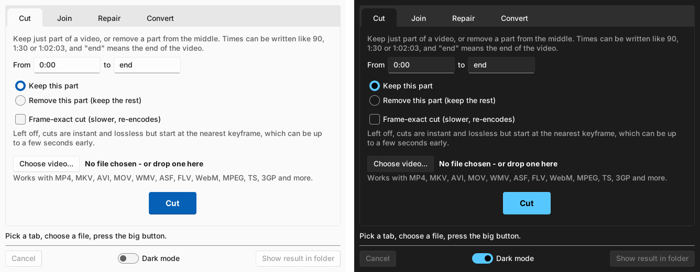

<p align="center">
  
</p>

<h1 align="center">TeaCut</h1>

<p align="center">
  <b>Cut, join, repair and convert almost any video, losslessly, in one tiny window.</b><br>
  A revival of the classic <a href="https://www.videohelp.com/software/Steeper">Steeper</a>, rebuilt for every format.
</p>

<p align="center">
  <a href="https://github.com/SeanShaffer88/TeaCut/releases/latest"><b>⬇ Download TeaCut.exe for Windows</b></a>
  &nbsp;·&nbsp;
  <a href="#run-from-source-windows-mac-linux">Mac / Linux</a>
</p>

<p align="center">
  
</p>

---

## Why

**Steeper** was a small freeware tool for repairing, cutting and joining
ASF/WMV files, built on the ASFCut command-line utility. It was simple and fast,
but it only handled Windows Media files and has long been abandoned.

TeaCut keeps the simple, fast part and runs on [FFmpeg](https://ffmpeg.org/)
underneath, so it opens practically anything:

> MP4 · MKV · AVI · MOV · WMV · ASF · FLV · WebM · MPEG/MPG · VOB · TS · M2TS/MTS ·
> 3GP · OGV · RM/RMVB · DV · MXF · DivX/Xvid · raw H.264/H.265 · and many more

## What it does

| Tab | What it's for |
|-----|---------------|
| ✂️ **Cut** | Keep a section, or remove a section and keep the rest. Instant and lossless by default; tick *Frame-exact* to cut on the exact frame. |
| ➕ **Join** | Put several videos end to end. Matching files join losslessly in seconds. Mismatched files (different sizes, formats, or some without sound) are converted to match automatically. |
| 🩹 **Repair** | Fixes videos that won't open, can't seek, show the wrong length, stutter or stop early. The quick fix rebuilds the file losslessly; *Deep repair* re-encodes and rebuilds every timestamp for badly damaged files. |
| 🔄 **Convert** | MP4, MKV, WebM, MOV, AVI, WMV, ASF, MPEG-2, TS, FLV, M4V, 3GP or OGV. Any stream the new format already supports is copied untouched; only the rest is converted. |

* **Lossless first.** Whenever it can, TeaCut copies the video data as-is, with no quality loss. It re-encodes only when there's no other way.
* **Nothing is overwritten.** Results are saved next to the original, e.g. `holiday_cut.mp4`.
* **No setup.** The Windows `.exe` has FFmpeg built in. Download it and run it.
* **Light and dark mode.** A Windows 11 style look that follows your system setting, with a switch to flip it. TeaCut remembers your choice.

## Download (Windows)

Grab **`TeaCut.exe`** from the [latest release](https://github.com/SeanShaffer88/TeaCut/releases/latest) and double-click it.
There's nothing to install. Windows SmartScreen may warn about an unrecognised app the
first time; click *More info → Run anyway*.

## Run from source (Windows, Mac, Linux)

1. Install [Python 3](https://www.python.org/downloads/) (on Windows, tick *"Add python.exe to PATH"*).
2. Download this repository and double-click **`TeaCut (Windows).bat`**, or **`teacut-mac-linux.command`** on Mac/Linux.

The first launch installs a private copy of FFmpeg (via `imageio-ffmpeg`).
If FFmpeg is already installed, or `ffmpeg.exe` sits next to `teacut.py`, that copy is used instead.
On Linux you may need Tk: `sudo apt install python3-tk`.

## Command line

The same engine is available from a terminal:

```
python teacut.py cut video.wmv --start 1:30 --end 2:45 [--remove] [--exact]
python teacut.py join part1.mp4 part2.mp4 part3.avi -o all.mp4
python teacut.py repair broken.asf [--deep]
python teacut.py convert old.wmv -o new.mp4
python teacut.py info video.mkv
```

Times can be written as `90`, `1:30`, `01:02:03.5` or `1m30s`.

## Limits

* Lossless cuts snap to the nearest keyframe, so the start can be off by a second or so. Tick *Frame-exact* if that matters.
* An MP4/MOV whose recording was cut off (camera lost power, "moov atom not found") is missing its index entirely. Rebuilding that needs a tool such as [untrunc](https://github.com/anthwlock/untrunc) and a healthy reference file from the same camera.

## Building the exe

Every push is built and tested on Windows by [GitHub Actions](.github/workflows/build.yml);
changing `VERSION` in `teacut.py` publishes a new release with `TeaCut.exe` attached.
To build locally, see [build-exe.txt](build-exe.txt).

## License

[MIT](LICENSE). FFmpeg, which the Windows exe bundles, is licensed under the GPL/LGPL; see [ffmpeg.org/legal](https://ffmpeg.org/legal.html).
